[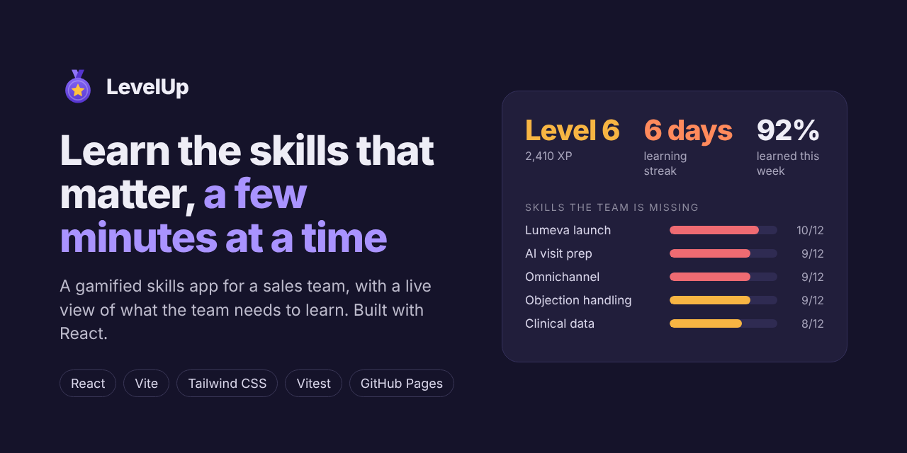](https://diogos7.github.io/LevelUp/)

# LevelUp

[](https://github.com/DiogoS7/LevelUp/actions/workflows/ci.yml)

**Learn the skills that matter, a few minutes at a time.** Try it live: **[diogos7.github.io/LevelUp](https://diogos7.github.io/LevelUp/)**

LevelUp is a learning app for a sales team that feels like a game. It follows the field sales team of Solenne Biosciences, a made-up pharmaceutical company in Portugal, as they get ready to launch a new (also made-up) medicine called Lumeva. It answers three questions in plain words:

1. **What should I learn next?** Every skill has a level from 0 to 5, and each role needs a certain level. LevelUp shows each person where they fall short, starting with the skills the company needs most right now.
2. **How do I learn it without losing a day?** Through quests: a 5-minute lesson, a 3-question quiz or a short practice task. Each one earns points (XP), keeps a daily streak going and can unlock badges.
3. **What does the whole team need?** Managers see which skills the team is missing, who is ready for the launch, who has stopped learning, and which practice tasks are waiting for their review.

**New in v2.0: the Course studio.** AI creates the training, the game gets people to do it, and managers see the gaps close. [Jump to the Course studio](#course-studio-new-in-v20).

## The problem it solves

Learning tools for sales teams usually have two problems:

- **Nobody uses them.** Long courses compete with a full diary of customer visits, and they lose.
- **Nobody can see the gaps.** Managers can't tell which skills the team lacks, which of those matter most, or whether training is working.

LevelUp tackles both. Quests are short, progress is visible straight away and the weekly leaderboard resets every Monday, so people keep coming back. Every quest is linked to a skill, so all that learning adds up to a live picture of the team for the people who plan training.

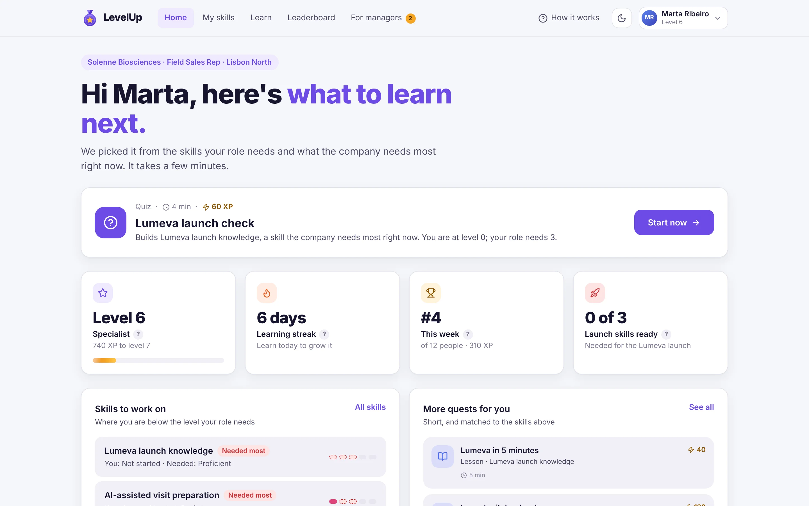

## What a manager sees

The **For managers** page opens with the headlines in plain words, worked out from the data:

- **Lumeva launch knowledge is the biggest gap:** 10 of 12 people are below the level their role needs.
- **Only 2 of 12 are ready for the launch**, meaning at the needed level in launch knowledge, clinical data and objection handling.
- **92% learned something this week**, up from 42% eight weeks ago.
- **1 person needs a nudge:** Pedro hasn't learned anything in over a week.

Below that: which skills to train first (how many people lack each skill against how much the company needs it), a ranked list of training priorities, everyone's skills at a glance with a spreadsheet download, an 8-week adoption chart, practice tasks to approve, and a list of people to nudge.

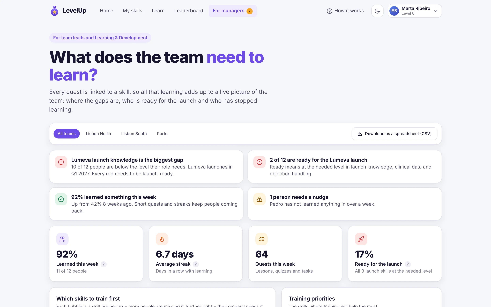

## Course studio (new in v2.0)

Managers and Learning & Development turn a company document into a short course. AI drafts it, a person checks every part against the document, and once it's approved the reps can play it straight away.

1. **Pick a source.** Start from approved material: the built-in Lumeva product leaflet or the field guide to handling a doctor's objections (both made up). Choose the skill the course trains. The document is shown as numbered sentences.
2. **Let AI draft it.** LevelUp drafts a 5-minute lesson, a 3-question quiz and a practice task. Every point and question lists the sentences it came from. The built-in documents use prepared sample output, so the demo works offline with no API key.
3. **Check it against the source.** Each part sits next to the document with its sentences highlighted. Mark it **OK** or **Remove**. Anything that isn't in the document is flagged **Not in the source** and can only be removed. Each sample draft has one of these on purpose, to show the check working.
4. **Approve and it goes live.** Approving records who approved it and when. The course appears in **Learn** for every rep, tagged **New**, and earns XP, streaks and badges like any other quest. **Send back** keeps it as a draft with a note.

Nothing reaches the reps until a person approves it.

| Course studio | Review against the source |
| --- | --- |
| 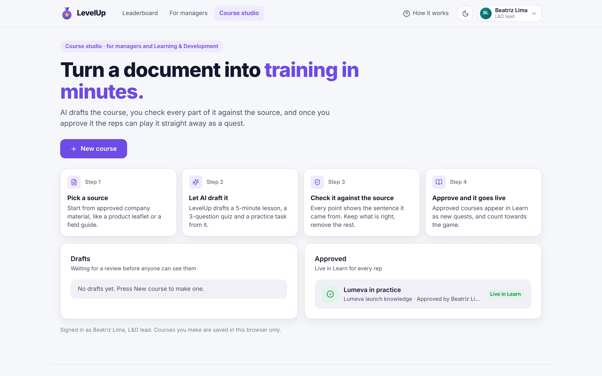 | 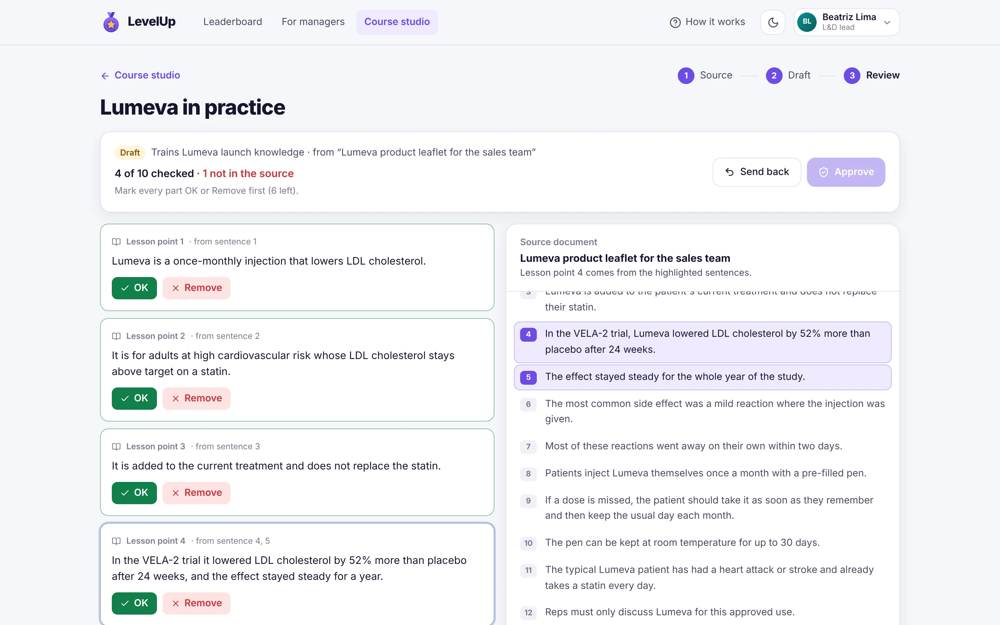 |

| Choose a source | The new course in Learn |
| --- | --- |
| 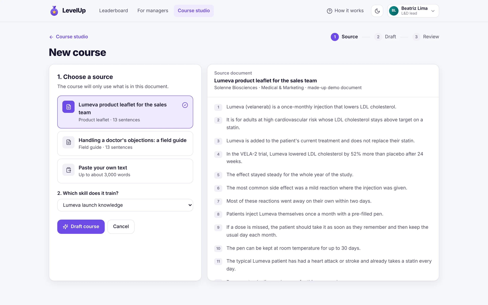 | 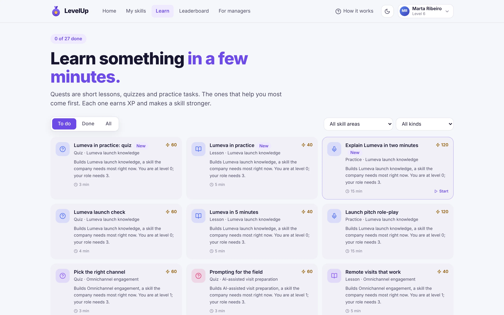 |

**Try the whole loop:** open the menu in the top-right corner and choose **Beatriz Lima** (L&D lead) → **Course studio** → **New course** → **Draft course** → mark every part OK or Remove → **Approve**. Then switch to **Marta Ribeiro**, play *Lumeva in practice: quiz* in **Learn**, switch back and open **For managers**: Lumeva launch knowledge goes from 22 to 21 levels to go.

## Making it a game, fairly

| Game element | How it works |
| --- | --- |
| **XP and levels** | Every quest earns XP. Collect enough and you move up a level, from Rookie to Master. |
| **Streaks** | Learn something every day to keep your streak going. |
| **Badges** | Eight badges, like *Launch ready*, *Quiz ace* and *AI pioneer*. Tap any badge to see how to earn it. |
| **Weekly leaderboard** | Everyone starts at zero on Monday, so anyone can win next week. Teams are ranked on points per person, so a small team can beat a big one. |
| **Team goal** | The whole field force works towards 80 Lumeva quests before the end of November. |

Points come only from learning, never from sales figures. Quizzes pay for correct answers, and practice tasks need a quick yes from a team lead before the points are added, so the game rewards real learning rather than clicking.

## Screenshots

| My skills | Learn |
| --- | --- |
| 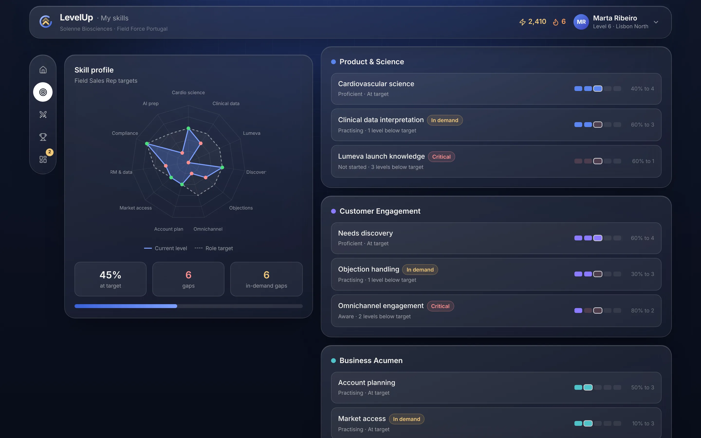 | 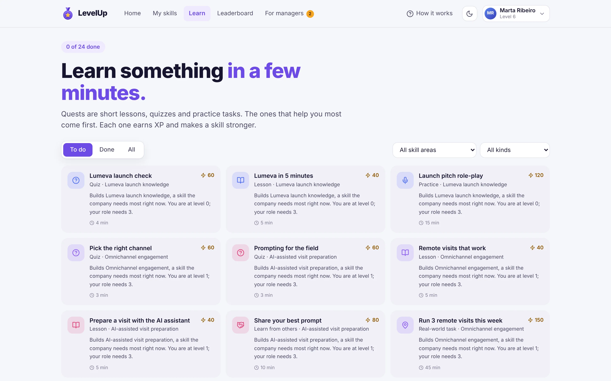 |

| A quiz | One skill up close |
| --- | --- |
|  | 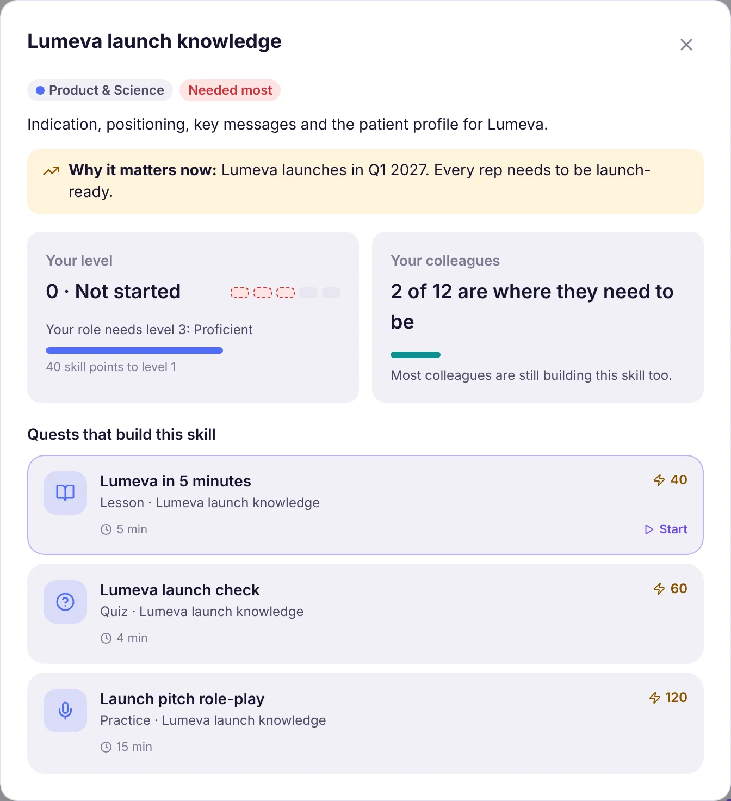 |

| Leaderboard | Welcome guide |
| --- | --- |
| 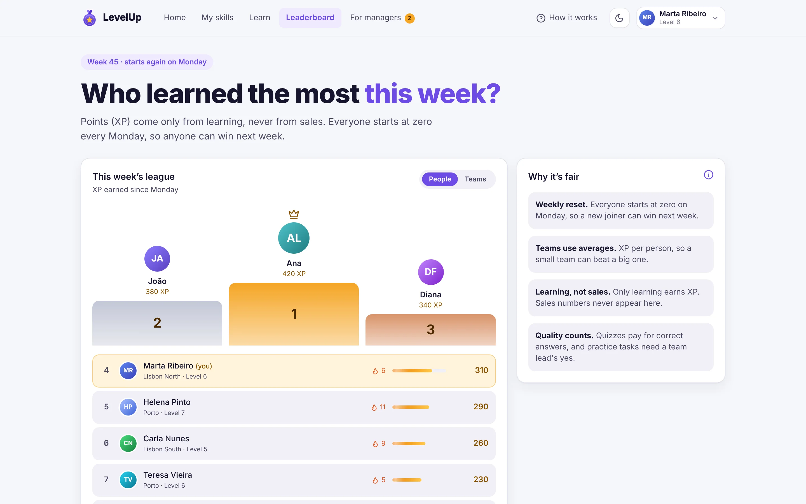 | 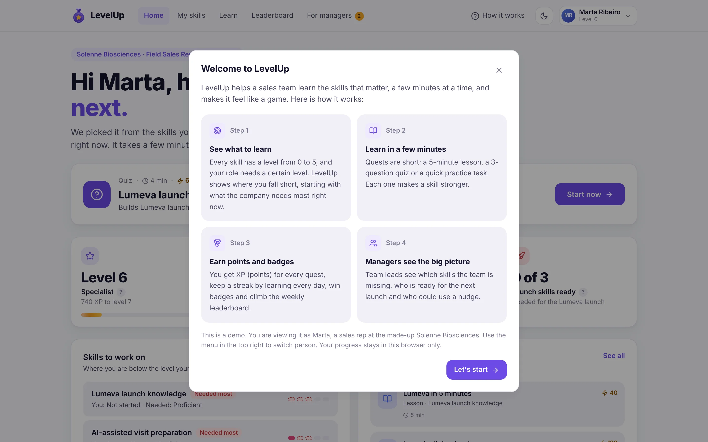 |

| Which skills to train first | Everyone's skills at a glance |
| --- | --- |
| 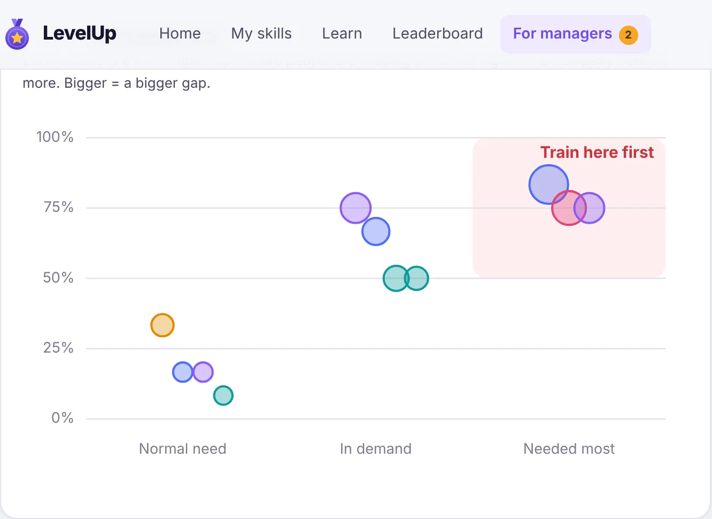 | 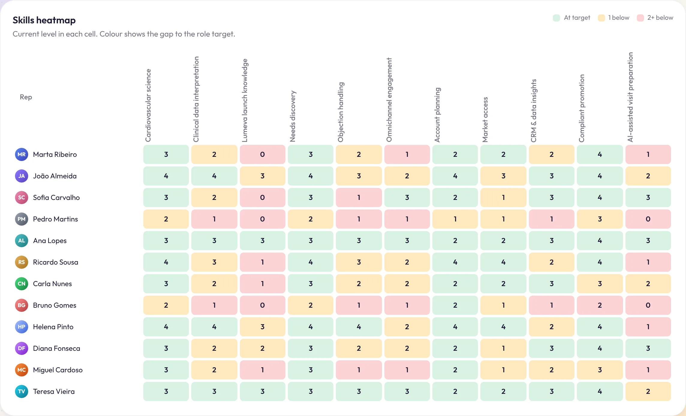 |

| Dark theme | Phone |
| --- | --- |
| 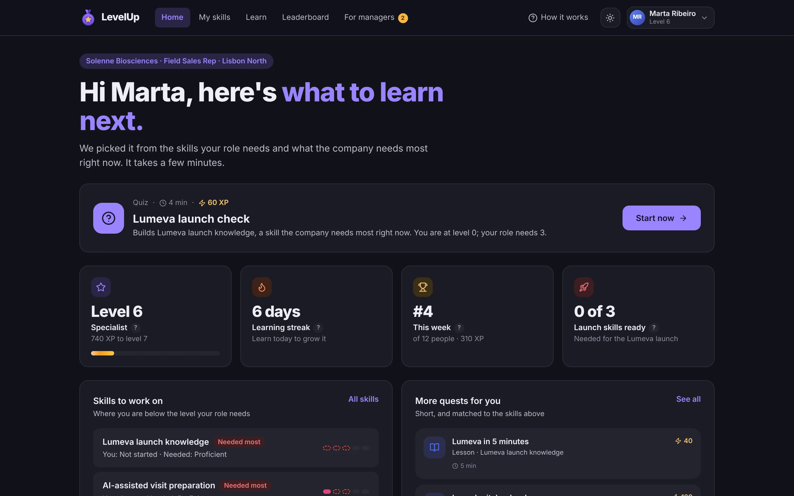 | 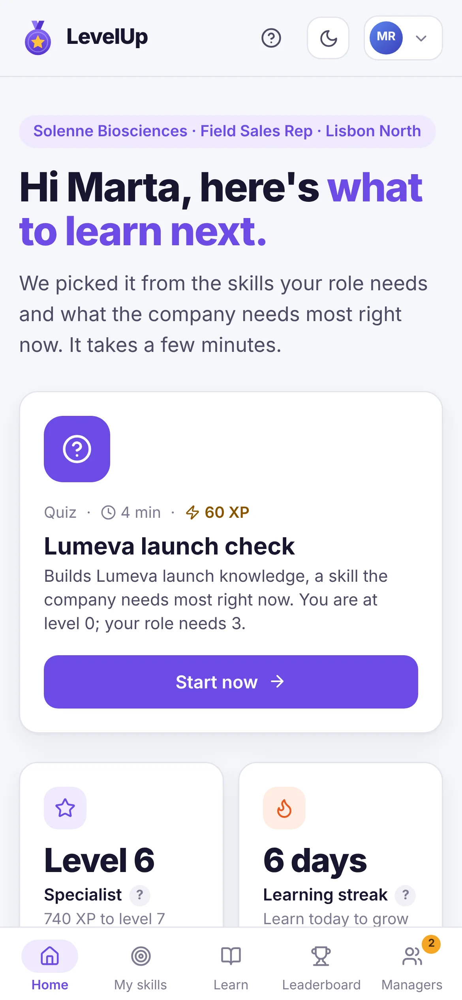 |

## Try the demo

- A short guide opens on your first visit. You can reopen it any time with **How it works**.
- Press **Start now** on the home page, answer the quiz and claim your XP. Your skills, badges, rank and the team goal all update.
- Use the menu in the top-right corner to **see the app as any of the 12 reps**, or as a team lead or the L&D lead, who get the **Course studio**.
- Open **For managers** to approve a practice task, then switch to that person to see their points.
- Switch between light and dark with the moon/sun button. By default the app follows your device.
- Progress is saved in your browser only. **Start again** in the footer clears it.

## For the technical reader

| | |
| --- | --- |
| UI | React 19, Tailwind CSS v4 with light and dark colour tokens, Framer Motion |
| Icons | Lucide, via `react-icons/lu` |
| Charts | Hand-written SVG (skill radar, train-first chart, adoption trend), no chart library |
| Build | Vite 7 |
| Tests | Vitest unit tests for every game rule, manager headline and Course studio rule (`src/lib/*.test.js`) |
| CI/CD | GitHub Actions runs the tests and the build on every push and pull request, then publishes `main` to GitHub Pages |

Every rule lives in `src/lib/` as a pure function (data in, data out): skill levels and gaps, the quest suggestions, XP and levels, badges, the leaderboards, the manager headlines and the CSV export. That keeps the rules testable without rendering anything. Connecting a real source, such as a learning platform, a CRM or an HR system, only means replacing `src/data/academy.js`.

```
src/
├── App.jsx                # Game state, saving progress, notifications, level-up celebration
├── components/
│   ├── Chrome.jsx         # Top menu, phone tab bar, welcome guide, theme toggle, footer
│   ├── QuestPlayer.jsx    # Lessons, playable quizzes and practice tasks
│   ├── QuestCard.jsx
│   ├── SkillDetail.jsx
│   ├── studio/            # Course studio: source, drafting, review and the document panel
│   ├── Card.jsx
│   └── ui.jsx             # Logo, avatar, bars, level blocks, chips, tips, modal, buttons
├── views/                 # Home, Skills, Learn, Leaderboard, For managers, Course studio
├── data/
│   ├── academy.js         # Made-up skills, role levels, demand, people and quests
│   ├── sources.js         # Built-in source documents for the Course studio
│   └── drafts.js          # Prepared AI drafts for those documents (offline demo)
└── lib/
    ├── game.js            # The game rules
    ├── sentences.js       # Splitting a document into numbered sentences
    ├── draft.js           # The shape of a draft and matching it to the source
    ├── courses.js         # Reviewing, approving and turning courses into quests
    └── *.test.js
```

## Run it yourself

You need Node.js 20 or later.

```bat
git clone https://github.com/DiogoS7/LevelUp.git
cd LevelUp
npm install
npm run dev
```

Then open http://localhost:5173.

| Command | What it does |
| --- | --- |
| `npm run dev` | Start the app with live reload |
| `npm test` | Run the unit tests once |
| `npm run build` | Build the site into `dist/` |
| `npm run preview` | Serve the built site locally |

## Why I built it

Getting people to actually use a learning tool is hard, and so is knowing which skills a sales team is missing. I wanted to show how I'd approach both as a business analyst and QA consultant: turn the business need into clear rules (targets per role, demand per skill, what earns XP), keep those rules testable, and design the experience so that using it feels rewarding rather than mandatory.

## License

[MIT](LICENSE) © Diogo Santos
