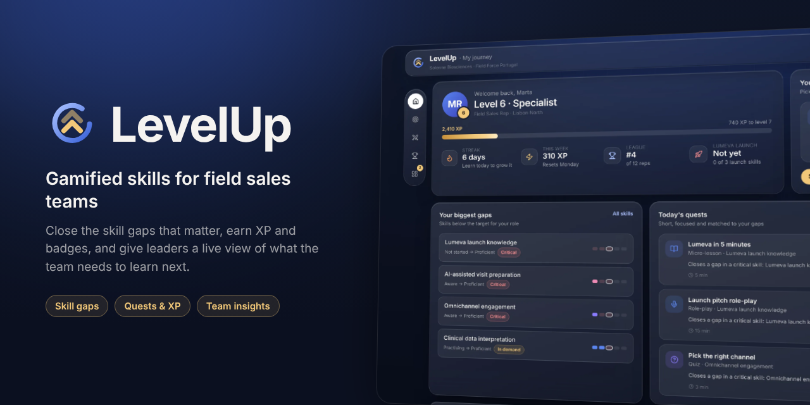
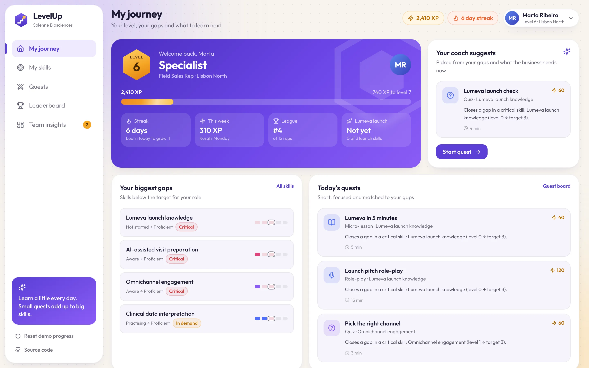
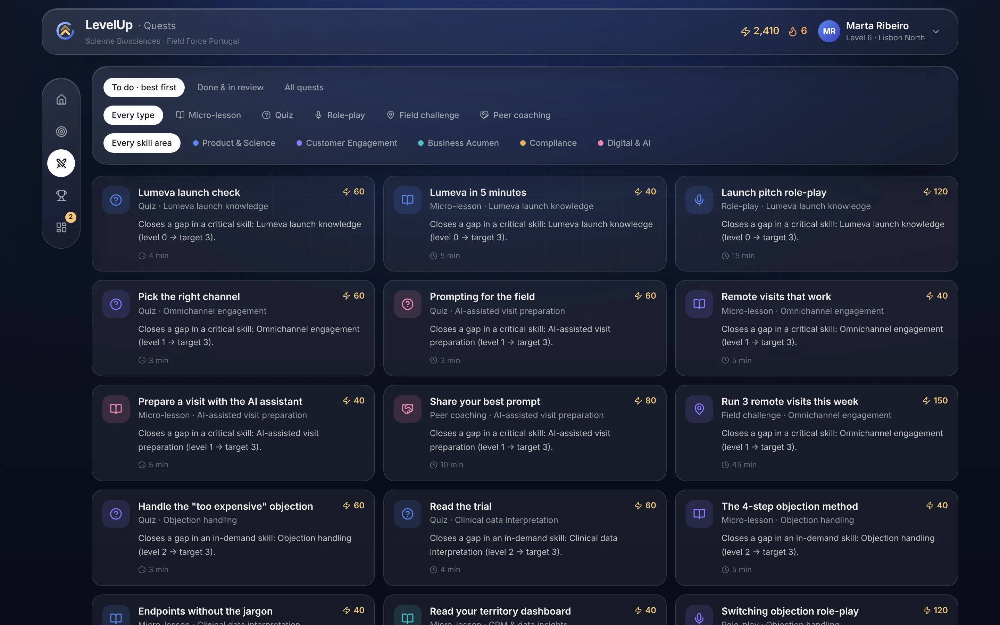
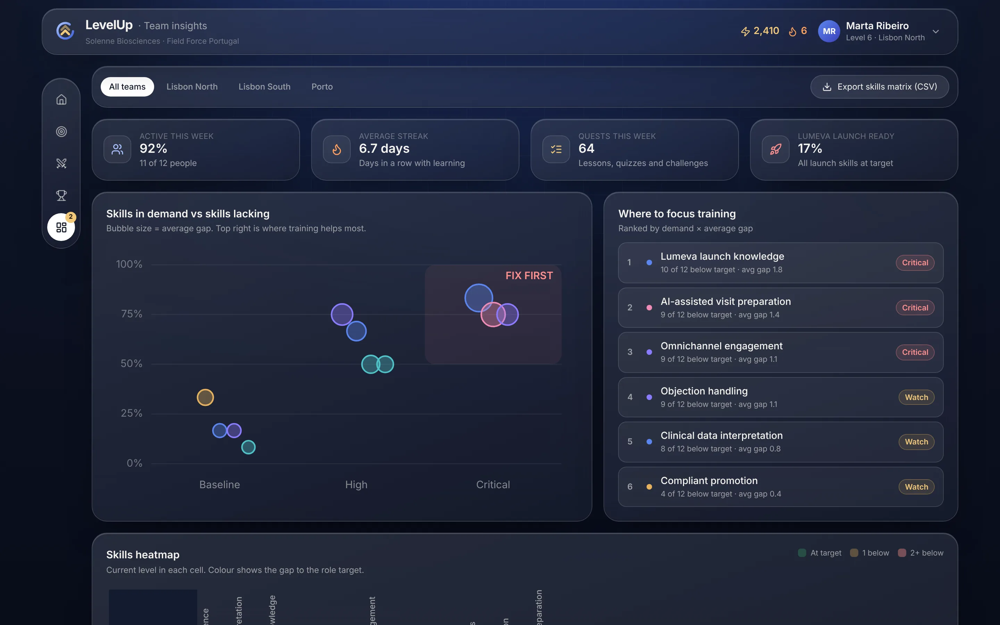
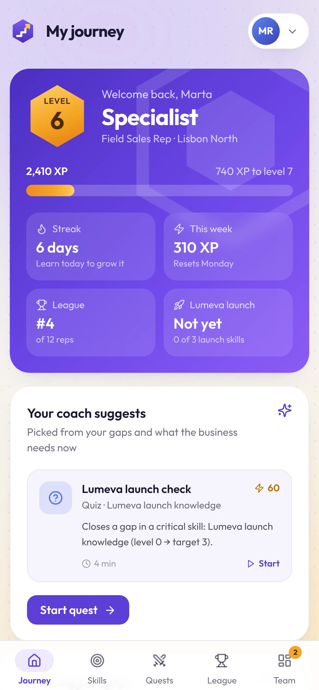
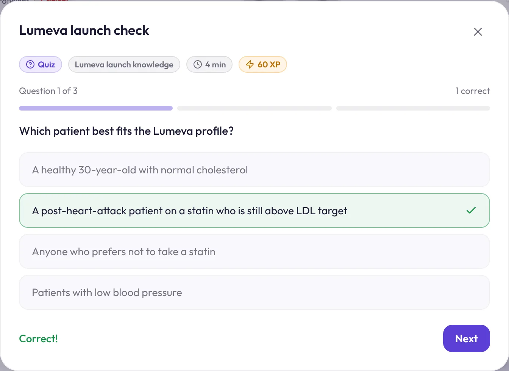
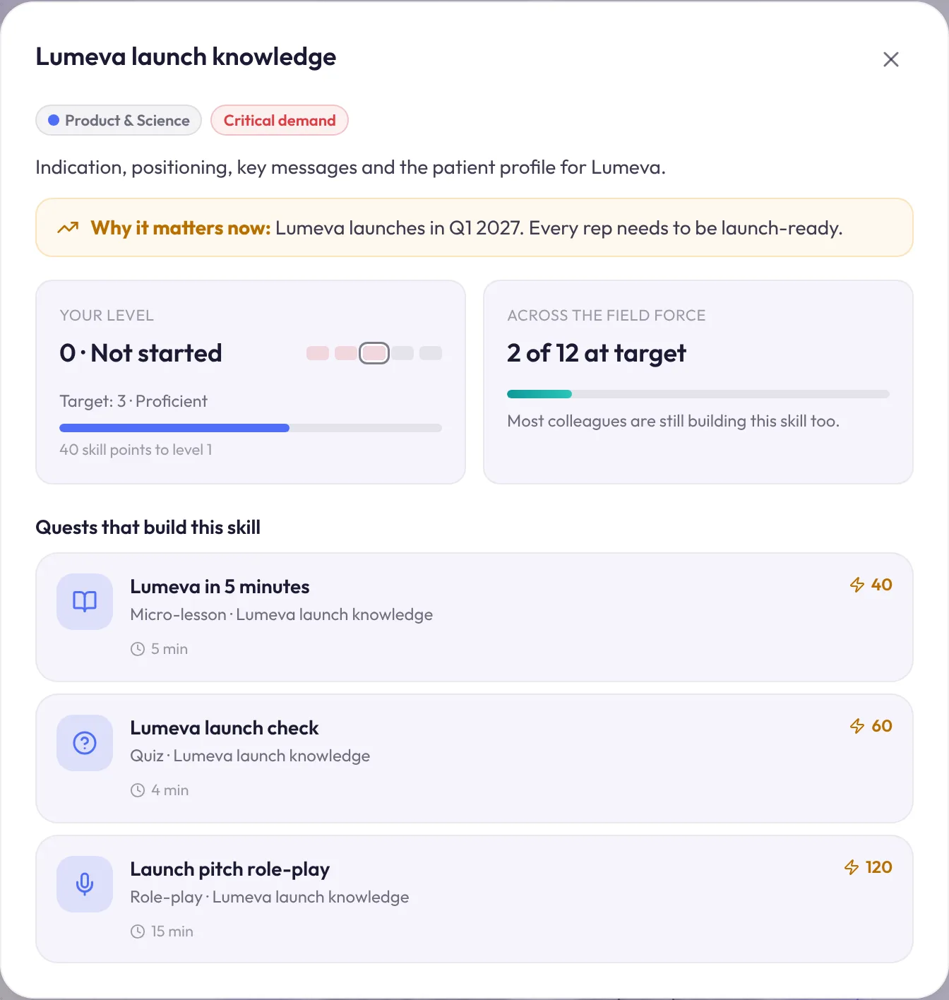
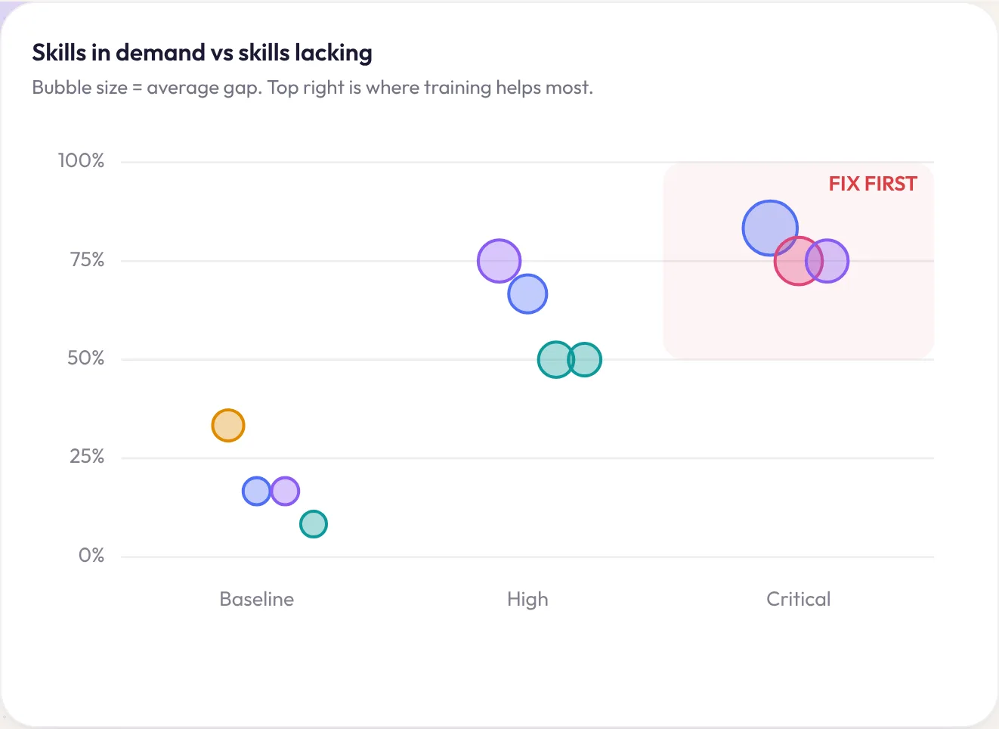
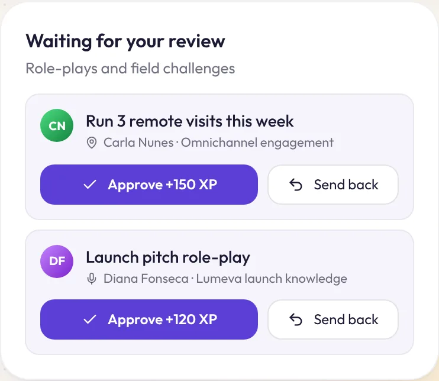

# LevelUp

[](https://github.com/DiogoS7/LevelUp/actions/workflows/ci.yml)

*Gamified skills for field sales teams.*

LevelUp is a skills platform for pharmaceutical field sales reps that people actually want to open. Each rep sees which of their skills are below target and which skills the business needs most right now. They close those gaps through short quests and earn XP, levels, streaks and badges along the way. Team leads and Learning & Development get a live view of where the team is lacking skills, how ready it is for the next launch, and whether people are really using the tool.

The data is fictional: a field force for the made-up **Solenne Biosciences** in Portugal, preparing for the launch of a made-up medicine called **Lumeva**. Every person, product and number is synthetic.

**Live demo:** https://diogos7.github.io/LevelUp/

## The problem it solves

Learning platforms for field teams often have two problems:

1. **Nobody uses them.** A catalogue of long courses competes with a full diary of customer visits, and it loses.
2. **Nobody can see the gaps.** Managers don't know which skills the team lacks, which of those matter most for the business, or whether training is working.

LevelUp tackles both. Gamification drives adoption: quests take 3 to 15 minutes, progress is visible, the week's league resets every Monday, and the whole field force works towards a shared team goal. Every quest is linked to a skill, every skill has a target per role and a business demand level, so all that activity turns into a live skills picture for the people who plan training.

## Views












### Highlights

| | |
|---|---|
|  |  |
|  |  |

## What it does

### For reps

- **Skill profile.** 11 skills in 5 areas (Product & Science, Customer Engagement, Business Acumen, Compliance, Digital & AI), each with a level from 0 *Not started* to 5 *Expert* and a target for the rep's role. Field Sales Reps and Key Account Managers have different targets.
- **Why it matters now.** Skills carry a business demand level (baseline, high or critical) and a plain-language reason, for example *"Lumeva launches in Q1 2027"*. Compliance is marked as mandatory.
- **Coach suggestion.** The next best quest is picked from the rep's gaps, weighted by demand, and comes with a reason: *"Closes a gap in a critical skill: Lumeva launch knowledge (level 0 → target 3)."*
- **Quests.** Five types: micro-lessons, quizzes, role-plays, field challenges and peer coaching. Quizzes are playable, pay XP for correct answers, need 2 of 3 to pass and give a bonus for a perfect score. Role-plays and field challenges go to the team lead for review before the XP is awarded.
- **XP, levels and streaks.** Player levels with titles (Rookie, Explorer, Specialist, Expert, Master), a daily learning streak, and skill points that raise skill levels. Level-ups get a celebration.
- **Badges.** Eight badges, such as *Launch ready*, *AI pioneer*, *Quiz ace* and *Team player*. Locked badges show how to earn them.
- **Team challenge.** A shared goal (80 Lumeva quests before 30 November) that every launch quest counts towards.

### For team leads and L&D

- **Adoption KPIs.** People active this week, average streak, quests completed this week and an 8-week trend.
- **Skills in demand vs skills lacking.** A matrix of business demand against the share of people below target. The top-right corner is where training helps most.
- **Where to focus training.** Skills ranked by demand × average gap and labelled *Critical*, *Watch* or *Healthy*.
- **Launch readiness.** The share of reps at target in every launch skill.
- **Skills heatmap.** Every rep against every skill, coloured by the gap to target. Filter by team and export it to CSV.
- **Reviews and nudges.** Approve or send back role-plays and field challenges, and nudge anyone who hasn't learned in 7 days.

### Gamification that stays fair

- The league resets every Monday, so a new joiner can win next week.
- Teams are ranked on XP per person, so a small team can beat a big one.
- Only learning earns XP. Sales figures never appear in the game.
- Quality counts: quizzes pay for correct answers, and role-plays need a coach's approval.

## Try the demo

- Use the menu in the top-right corner to **play as any of the 12 reps**.
- Start the coach's suggested quest on *My journey*, answer the quiz and claim the XP. Your skills, badges, league position and the team challenge all update.
- Open **Team insights** to approve a pending role-play, then switch to that rep to see their XP.
- Progress is saved in your browser only. **Reset demo progress** in the same menu starts again.

## Tech stack

| | |
|---|---|
| UI | React 19, Tailwind CSS v4 (custom `glass` utility), Framer Motion |
| Icons | Lucide, via `react-icons/lu` |
| Charts | Hand-written SVG (radar, demand matrix, adoption trend), no chart library |
| Build | Vite 7 |
| Tests | Vitest unit tests for every game rule (`src/lib/game.test.js`) |
| CI/CD | GitHub Actions runs the tests and the build on every push and PR, then deploys `main` to GitHub Pages |

## Getting started

You need Node.js 20 or later.

```bat
git clone https://github.com/DiogoS7/LevelUp.git
cd LevelUp
npm install
npm run dev
```

Then open http://localhost:5173.

| Command | What it does |
|---|---|
| `npm run dev` | Start the dev server with hot reload |
| `npm test` | Run the unit tests once |
| `npm run test:watch` | Re-run tests on save |
| `npm run build` | Production build into `dist/` |
| `npm run preview` | Serve the production build locally |

## Project structure

```
src/
├── App.jsx                # Game state, persistence, toasts and level-up celebrations
├── components/
│   ├── Chrome.jsx         # Top bar, rep switcher, dock, toasts, level-up modal
│   ├── QuestPlayer.jsx    # Lessons, playable quizzes and review submissions
│   ├── QuestCard.jsx
│   ├── SkillDetail.jsx
│   └── ui.jsx             # Logo, avatar, bars, level pips, chips, modal, buttons
├── views/                 # Home, Skills, Quests, Leaderboard, Team
├── data/academy.js        # Synthetic skills, targets, demand, reps and quests
└── lib/
    ├── game.js            # Levels, gaps, recommendations, badges, leagues, insights, CSV
    └── game.test.js
```

Every rule lives in `lib/game.js` as a pure function, so it is tested without rendering anything. Connecting a real source, such as an LMS, a CRM or an HR system, only means replacing `data/academy.js`.

## Why I built it

Getting people to actually use a learning tool is hard, and so is knowing which skills a sales team is missing. I wanted to show how I'd approach both as a business analyst and QA consultant: turn the business need into clear rules (targets per role, demand per skill, what earns XP), keep those rules testable, and design the experience so that using it feels rewarding rather than mandatory. It sits alongside my Power Platform ([Houston](https://github.com/DiogoS7/Houston)), Salesforce ([Launchpad](https://github.com/DiogoS7/Launchpad)) and React ([QualityView](https://github.com/DiogoS7/QualityView)) projects.

## License

[MIT](LICENSE) © Diogo Santos
